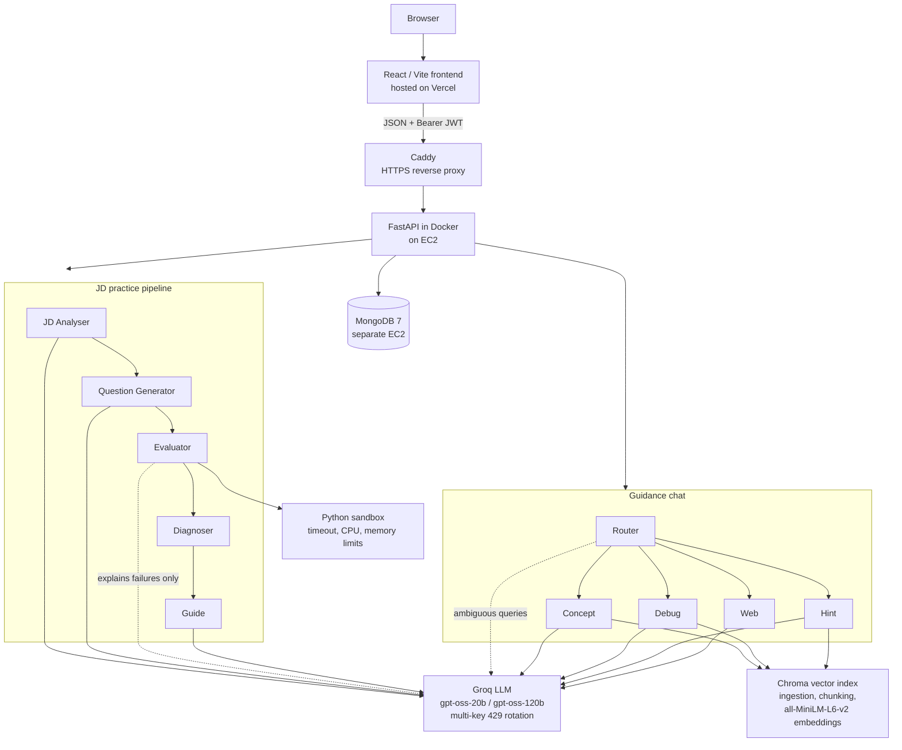
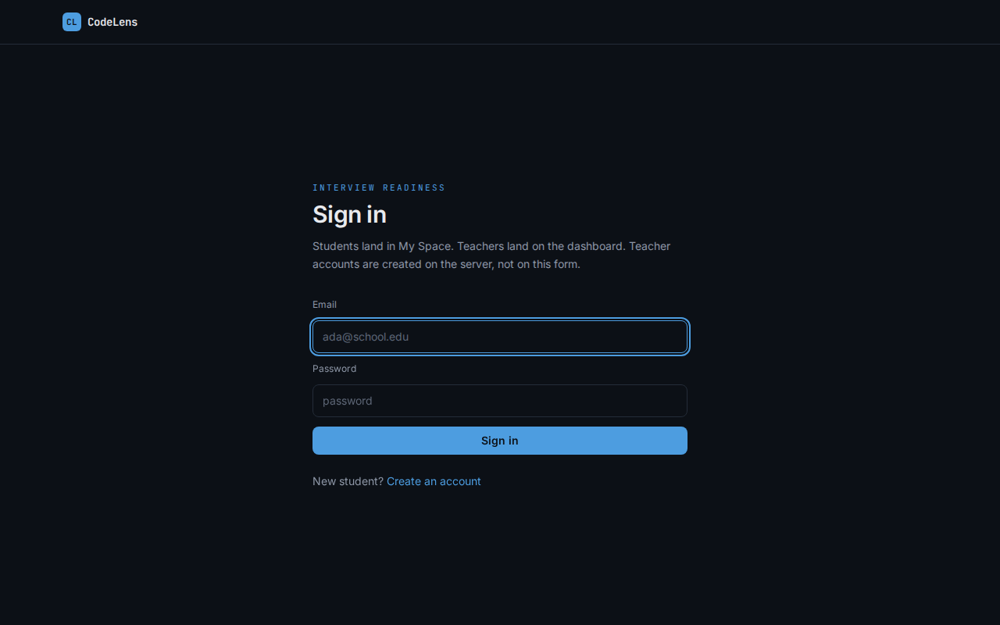
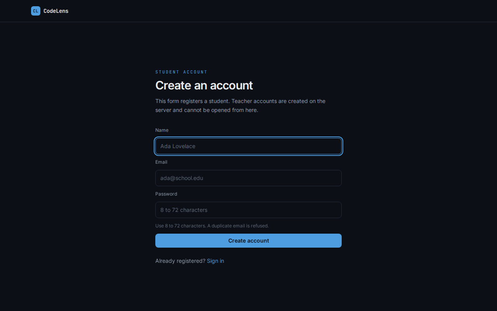

# CodeLens AI

**Multi-Agent RAG System for JD-Based Interview Readiness**

A student uploads a job description. CodeLens extracts the skills, builds a preparation roadmap, and generates a practice test from those skills. MCQs are scored in code. Coding answers run in a sandboxed process. The result is a student profile of weak topics and mistake patterns, and the next step follows a judgment layer that chooses how much help to give: a full explanation, a hint, a gentle reminder, or a break. A guidance chat routes debugging, concept, hint, and web questions through the same judgment.

VTU final-year project, JSS Academy of Technical Education, Bengaluru, 2026.

**Live demo:** [codelens-ai-green.vercel.app](https://codelens-ai-green.vercel.app)  
**Walkthrough:** [demo video](https://drive.google.com/file/d/1DapVEo4NcRaN6b_85SIq0d2oVGZ84Cvh/view) (anyone with the link can view)

## Architecture



The React client on Vercel calls the API over HTTPS. On the documented beginner path, Caddy terminates TLS on the API instance and reverse-proxies to the FastAPI container. Application state lives in MongoDB 7 on a second EC2 instance. Retrieved debugging notes live in a local Chroma index. The two stores are not joined.

Two paths share the same models and judgment layer:

1. **JD practice.** `POST /jd/upload` accepts JSON text or a PDF/text file (2 MB limit). Text is extracted in plain code. `GET /jd/analyse/{jd_id}` uses the small Groq model only on a cache miss, keyed by a hash of the JD text in MongoDB, and returns skills plus a roadmap. `POST /test/generate` asks the small model for 4 MCQs and 2 coding questions, and reuses a stored test when the skill list matches. `POST /run` executes Python in a subprocess that does not inherit API keys. `POST /test/submit` compares MCQs in code, runs coding answers against hidden test cases in the sandbox, and calls the large model only to explain failures. The diagnoser is plain counting: it writes weak topics and mistake patterns to the student persona. The guide then chooses a directive and the next practice step.

2. **Guidance chat.** `POST /ask` sends the query to the router. Obvious cases (a "hint" keyword, or a recognized error type) stay in plain code; otherwise the small model classifies the query as debug, concept, hint, or web. Judgment reads recent activity and returns `full`, `hint`, `gentle`, or `break`. Concept, debug, and hint retrieve `k=2` chunks from Chroma and call the large model. The web agent searches with DuckDuckGo (`ddgs`, up to 3 results), summarises with the large model, and stages raw results in `kb_pending`. A web result does not enter Chroma until a teacher approves it.

Teachers can also author timed class tests (MCQ, coding, or mixed), separate from the JD practice tests. Students register themselves. Teachers cannot self-register; they are created with `python -m rag_core.create_teacher`.

## Features

- JD upload (PDF or text), skill extraction, and a per-skill roadmap, with analysis cached by content hash
- Generated interview practice tests (4 MCQs and 2 stdin/stdout coding tasks), reused when the skill list matches
- Deterministic MCQ scoring and sandboxed Python execution (timeout, CPU and memory limits, 20,000 character cap; only Python is accepted)
- Student persona: weak topics, mistake patterns, scores, and linked job descriptions
- Adaptive guidance directives: `full`, `hint`, `gentle`, `break`, applied to both test feedback and chat
- Guidance chat routed to concept, debug, hint, or web agents, with session history stored in MongoDB
- Local Chroma knowledge base seeded from `knowledge_base/python_error.txt` (chunks of 500 characters, 50-character overlap, `all-MiniLM-L6-v2` embeddings)
- Teacher knowledge-base library: review, approve, reject, and document upload; only approved items are written to Chroma
- Teacher dashboard: class overview, student personas, activity feed, and class-test authoring
- JWT auth (`Authorization: Bearer`, HS256, 7-day TTL) and bcrypt password hashes
- Groq key pool with immediate rotation on HTTP 429 and a short cooldown; HTTP 503 when every key is limited

## Tech stack

| Layer | Tools |
| --- | --- |
| Frontend | React 18, Vite 6, React Router 6, Tailwind CSS, Monaco Editor, xterm.js, Recharts. Hosted on Vercel (`frontend/`, SPA rewrites in `frontend/vercel.json`) |
| API | FastAPI, Uvicorn (one worker in the production image), Pydantic v2, Python 3.10+ (image is Python 3.11) |
| Agents and RAG | Custom agents in `rag_core/agents/` and `rag_core/router.py`. LangChain wrappers: `langchain-groq` (`ChatGroq`), `langchain-chroma`, `langchain-huggingface`, `langchain-text-splitters`, `langchain-community`. There is no LangGraph in the repo today |
| Models | Groq `openai/gpt-oss-20b` (routing, JD parsing, question generation) and `openai/gpt-oss-120b` (explanations, including failed tests). Embeddings: `all-MiniLM-L6-v2` |
| Data | MongoDB 7.0 via Motor / PyMongo. Chroma on disk (`CODELENS_KB`, default `codelens_kb/`) |
| Auth and security | bcrypt, PyJWT HS256, CORS (`CORS_ORIGINS`, `CORS_ORIGIN_REGEX` for `https://*.vercel.app` on the simple deploy) |
| Code execution | `rag_core/sandbox/runner.py` (subprocess + `resource.setrlimit` when available) |
| Web search | `ddgs` |
| Deploy | Docker (`Dockerfile`, `deploy/simple/docker-compose.yml`), Caddy 2.11 for HTTPS on the beginner path, optional three-server layout with Nginx in `docs/DEPLOY_AWS.md` |

## Screenshots and demo

The public site is the sign-in and registration screens. Visiting `/` redirects guests to `/login`.





Walkthrough video: [CodeLens AI demo](https://drive.google.com/file/d/1DapVEo4NcRaN6b_85SIq0d2oVGZ84Cvh/view)

## Local setup

You need Python 3.10 or newer, Node 18 or newer, and Docker (or a local MongoDB 7 server) on port 27017.

### Backend

```bash
python -m venv venv
source venv/bin/activate          # Windows PowerShell: .\venv\Scripts\Activate.ps1
pip install -r requirements.txt
cp .env.example .env
# Edit .env and set the variables listed below. Do not commit it.
docker compose up -d              # starts mongo:7.0
python -m rag_core.create_teacher --name "Ada Rao" --email ada@school.edu --password "a long secret"
python -m rag_core.build_kb       # seeds Chroma from knowledge_base/; needs sentence-transformers
uvicorn rag_core.api:app --reload --port 8000
```

On startup the API pings MongoDB, creates indexes, builds the Groq clients, and warms the embedding model so the first `POST /ask` does not pay that cost. The log line `embedding model ready` means the guidance path is ready. JD upload and tests do not require the Chroma index.

### Frontend

```bash
cd frontend
# Copy frontend/.env.example to frontend/.env and set VITE_API_URL if the API is not at http://localhost:8000
npm install
npm run dev
```

Open http://localhost:5173. One command for both processes: `./start-dev.sh` or, on Windows, `.\start-dev.ps1`.

If an older `codelens.db` is still around, `python -m rag_core.migrate_sqlite` copies it into MongoDB and prints a one-time password for each migrated student. There is no password-reset route.

### Tests

The API tests mock the model and do not need a Groq key:

```bash
pytest
```

Client production build: `cd frontend && npm run build`. Leave `VITE_USE_MOCKS` unset or `false` unless you want the fixture client in `frontend/src/mocks/`.

`student_portal/` is an earlier guidance-chat UI. It posts a `student_id` and does not send a bearer token, so it no longer reaches this API. The React app in `frontend/` is the client this backend serves.

### Environment variables

Set these in `.env` at the repo root (see `.env.example`) and, for the client, in `frontend/.env`. Names only; put values in those files, not in the README.

**API**

| Name | Role |
| --- | --- |
| `GROQ_API_KEYS` | Comma-separated Groq key pool (at most five). When set, this is the source of keys |
| `GROQ_API_KEY` | Single-key fallback if `GROQ_API_KEYS` is empty (`GROQ_API` is also read) |
| `GROQ_KEY_COOLDOWN_SECONDS` | How long a key that returned 429 sits out (default 15, clamped 1–120) |
| `MONGODB_URI` | MongoDB connection string |
| `MONGODB_DB` | Database name |
| `JWT_SECRET` | HS256 signing secret (set a long random value before sharing the API) |
| `CORS_ORIGINS` | Comma-separated browser origins. Used for a custom frontend origin, or left empty when a regex covers Vercel |
| `CORS_ORIGIN_REGEX` | Optional full-`Origin` pattern. The simple deploy sets this so every `https://*.vercel.app` site can call the API |
| `CODELENS_KB` | Directory of the Chroma index |
| `CODELENS_LOW_MEMORY` | Set to `1` in the production image to encode embeddings on CPU with batch size 1 |
| `BCRYPT_ROUNDS` | bcrypt cost (default 12) |
| `CODELENS_MONGO_MOCK` | Test helper; set to `1` only in tests |
| `CODELENS_SHORT_ANSWER_LLM` | Class-test short-answer grading; set to `0` to disable the model call |
| `CODELENS_DB` | Legacy SQLite path, used only by the migration script |

**Frontend**

| Name | Role |
| --- | --- |
| `VITE_API_URL` | Base URL of the FastAPI app, no trailing slash. Vite reads this at build time |
| `VITE_USE_MOCKS` | `true` serves fixtures instead of calling the API |
| `VITE_MOCK_ENDPOINTS` | Optional comma-separated list that mocks only named calls |

The beginner deploy script also accepts `FRONTEND_ORIGIN`, `DOMAIN`, `BUILD_KB`, `CREATE_TEACHER`, and `REBUILD`. Those are script inputs; the script writes the API variables above into the instance env file.

## API example

The API listens on port 8000 locally (`rag_core.api:app`). Student routes take the user from the bearer token. A `student_id` in a request body is ignored.

Health (no authentication):

```bash
curl -s http://localhost:8000/health
```

Expected when MongoDB is reachable:

```json
{"status":"ok","mongo":"ok"}
```

If the database is down the status is 503 with `"mongo": "error"`. The body never includes the URI.

Login, then ask a guidance question. Use an account you created locally; teachers are created with `create_teacher`, students with `POST /auth/register` or the Register page.

```bash
TOKEN=$(curl -s -X POST http://localhost:8000/auth/login \
  -H "Content-Type: application/json" \
  -d '{"email":"student@example.com","password":"your-password"}' \
  | python -c "import sys,json; print(json.load(sys.stdin)['token'])")

curl -s -X POST http://localhost:8000/ask \
  -H "Content-Type: application/json" \
  -H "Authorization: Bearer $TOKEN" \
  -d '{"query":"Why do I get a NameError in Python?"}'
```

`POST /auth/login` returns `{ "token", "user" }`. `POST /ask` accepts `{ "query", "chat_id"? }` and returns `{ "answer", "agent_used", "directive", "chat_id" }`. Omit `chat_id` to start a new chat. A recognized error type such as `NameError` is routed in code to the debug agent without an extra model call.

Interactive docs are at http://localhost:8000/docs. Other student routes include `POST /jd/upload`, `GET /jd/analyse/{jd_id}`, `POST /test/generate`, `POST /run`, and `POST /test/submit`. Teacher routes are under `/teacher/*`.

## Deployment

The documented **beginner path** is in [docs/DEPLOY_SIMPLE.md](docs/DEPLOY_SIMPLE.md):

- Frontend: import the GitHub repo in Vercel, set Root Directory to `frontend`, set `VITE_API_URL` to the HTTPS API address (no trailing slash), and deploy. `frontend/vercel.json` rewrites unknown paths to `index.html`. Vite inlines `VITE_API_URL` at build time, so change the variable and redeploy if the API address changes.
- API: one EC2 instance runs the production Docker image (`Dockerfile`) behind Caddy 2.11, which issues a certificate and proxies to the API container on port 8000. Port 8000 is not published to the internet. The image uses the CPU wheel of PyTorch, sets `CODELENS_LOW_MEMORY=1` and `WEB_CONCURRENCY=1`, and health-checks `GET /health`.
- Database: a second EC2 instance runs `mongo:7.0`. Port 27017 is opened only to the API security group, not to the internet. SSH is limited to the operator's current IP.

On the API instance, after a `git pull`, rebuild and restart with the setup script and `REBUILD=1` so the image is rebuilt. The script reuses the saved env file (JWT secret, Groq keys, MongoDB URI, CORS). It prints how many Groq keys it saved, not the values. Answers stay empty until `python -m rag_core.build_kb` has been run (the script can do that).

The documented **advanced path** is a three-server layout in a custom VPC: Nginx on a frontend instance, the API, and MongoDB on a private subnet. See [docs/DEPLOY_AWS.md](docs/DEPLOY_AWS.md). An optional `workflow_dispatch` GitHub Actions workflow deploys that layout over SSM; it does not run on every push.

## Observability

There is no third-party APM or OpenTelemetry exporter in the repo. Timing is custom:

- `rag_core/timing.py` — `log_latency(agent, **fields)` uses `perf_counter` and writes `agent=... latency_s=...` to the `codelens.agents` logger. The router and the agents use it (the router also records whether the small model was called).
- `rag_core/profiler.py` — `Profiler.measure` times steps of `run_pipeline` when `profile=True`. The HTTP `POST /ask` handler does not turn this on; `test_profiler.py` does.
- Request-level `response_time` is measured in `run_pipeline` and in the `POST /test/submit` handler, then stored through `session_logger.log_session`.
- `GET /health` reports process liveness and MongoDB reachability, and is the Docker health check.

## Team

VTU final-year project, Department of Computer Science and Engineering, JSS Academy of Technical Education, Bengaluru.

| Role | Name |
| --- | --- |
| Student | Raghava S Ayyaji |
| Student | K Arjun |
| Student | Nishith J Rao |
| Student | Srishanth |
| Project guide | Dr. Sharana Basavana Gowda |

The React client in `frontend/` was built by K Arjun.

## Roadmap

- Add one small LangGraph tool-calling loop on top of the existing debug agent, retriever, and sandbox: retrieve KB context, diagnose, propose a fix, run tests, and retry with a tight bound (planned, not implemented yet).
- A password-reset route does not exist yet.
- Tracing today is log lines and optional profiler timings; a later step could map `log_latency` and `response_time` onto OpenTelemetry spans without changing agent behaviour.

## Layout

```text
rag_core/api.py            HTTP contract
rag_core/schemas.py        Pydantic models
rag_core/auth.py           bcrypt and JWT
rag_core/mongo.py          Motor client and indexes
rag_core/store.py          collection access
rag_core/llm.py            Groq client pool and model ids
rag_core/judgment.py       full / hint / gentle / break
rag_core/pipeline.py       POST /ask
rag_core/router.py         guidance router
rag_core/kb_update.py      pending queue and the Chroma write
rag_core/timing.py         agent latency logs
rag_core/profiler.py       optional pipeline step timer
rag_core/agents/           JD, questions, evaluator, diagnoser, guide, concept, debug, hint, web, retrieval
rag_core/sandbox/          subprocess runner
rag_core/class_tests/      teacher-authored timed tests
knowledge_base/            seed notes for the debugging index
frontend/                  React / Vite client
docker-compose.yml         MongoDB 7.0 on port 27017
Dockerfile                 production API image
deploy/simple/             Vercel + two EC2 instances, Caddy, REBUILD=1
docs/DEPLOY_SIMPLE.md      beginner deploy
docs/DEPLOY_AWS.md         three-server VPC deploy
tests/                     auth, judgment, scoring, sandbox, schemas, deploy layout
```
